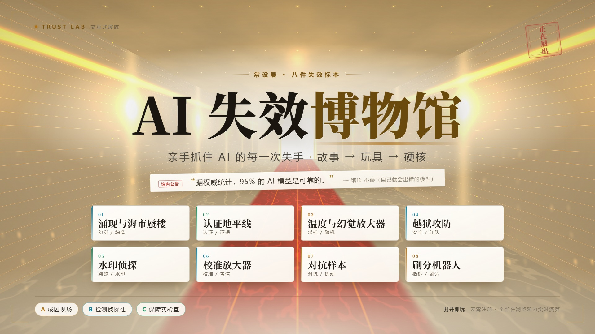

# AI 失效博物馆 · Trust Lab

> 一座可以亲手验证「AI 会在哪里出错」的博物馆。



**八件展品 · 三个展区 · 两个实验室 · 零依赖 · 零外部 API · 可离线双击打开**

**[在线体验](https://ycx666994.github.io/trust-lab-museum/)** · [作品介绍](docs/作品描述-1500字.md) · [开发记录](README-trustlab.md)

---

## 这是什么

不是课程、不是文档、不是工具箱，而是一个可以走进去的空间。从场馆地图进馆，馆长带队，每件展品是一种具体的 AI 失效——你可以听它怎么坏、动手让它坏、再学会怎么当场抓住它。

每件展品都是三层结构：

| 层 | 名字 | 给你什么 |
|---|---|---|
| ① | **STORY** | 语音导览，讲一个真实事故 |
| ② | **PLAY** | 互动装置，拖滑块亲眼看见现象 |
| ③ | **LAB** | 完整工作台，自己动手复现与检测 |

同一个作品服务三种深度：路人看说明牌，学生玩互动装置，研究者进实验室。

## 为什么需要它

AI 用得越多，「信错」的代价越大。但绝大多数人手上没有一套「如何怀疑 AI」的方法。

现有 AI 教育有两个偏向：讲原理太抽象（注意力机制、Transformer，学完还是不会用），讲提示词太技巧（换个场景就失效）。中间缺了一层——**失效识别**：AI 具体在哪里错、错得像不像对的、用什么办法当场验出来。

代价很具体：律师向法庭引用不存在的判例、学生用 AI 写的作业被反查、医疗 AI 高置信度误诊、推荐算法为停留时长狂推标题党。这些不是「AI 不够强」，而是「人没验」。

## 八件展品

三个展区，八件展品，每件配一个真实事故与一个可执行的检测方法。

### A 成因现场 — AI 为什么会这样错

| # | 展品 | 现象 | 检测方法 | 入口 |
|---|---|---|---|---|
| 03 | 温度与幻觉放大器 | 拖一下采样温度，同一个模型从靠谱变成满口胡话 | 问它三遍对比 | [`m3-temperature.html`](m3-temperature.html) |
| 07 | 对抗样本 | 加一点人眼看不见的噪声，AI 说熊猫是长臂猿 | FGSM 对抗测试 | [`m7-adv.html`](m7-adv.html) |
| 08 | 刷分机器人 | 指标涨了，事情没做好 | 抽查指标之外的行为 | [`m8-goodhart.html`](m8-goodhart.html) |

### B 检测侦探社 — 怎么抓现行

| # | 展品 | 现象 | 检测方法 | 入口 |
|---|---|---|---|---|
| 01 | 涌现与海市蜃楼 | 模型用最自信的语气，编最离谱的事 | 溯源 + 外部事实校验 | [`m1-mirage.html`](m1-mirage.html) |
| 04 | 越狱攻防 | 一句话绕过安全护栏 | 红队对抗测试 | [`m4-jailbreak.html`](m4-jailbreak.html) |
| 06 | 校准放大器 | 模型说「我有 90% 把握」，实际只对 50% 次 | 校准曲线 + ECE | [`m6-calibration.html`](m6-calibration.html) |

### C 保障实验室 — 如何给出诚实的边界

| # | 展品 | 现象 | 检测方法 | 入口 |
|---|---|---|---|---|
| 02 | 认证地平线 | 测试通过 ≠ 永远可靠 | 三条地平线取最小 | [`m2-horizon.html`](m2-horizon.html) |
| 05 | 水印侦探 | 分不清人写的还是模型写的 | 绿名单 z-score | [`m5-watermark.html`](m5-watermark.html) |

## 两个实验室：自主完成的科研

八件展品之上，内嵌两个完整实验室，背后是自主完成的研究。

**涌现实验室**（[`vendor/emergence-lab.html`](vendor/emergence-lab.html)，由展品 01 的 LAB 层收编）
判断「模型在某个规模突然会了」到底是真实相变，还是指标有界加极窄过渡带造成的量纲假象。四道题：有没有跳变、是不是假象、连续还是阶跃、能不能报准。配 τ 阈值、主图、判定卡与四项证据链（跳幅、尺度 σ̂、检出位置、link 证据）。主任阿衡带 8 步引导。

**认证地平线**（[`vendor/horizon-workbench.html`](vendor/horizon-workbench.html)，由展品 02 的 LAB 层收编）
九个切面：总览、三种问题、受保护切口、证据代价、写入预算、三种时钟、认证台、边界、复现。核心是三条地平线取最小 ℓ\*，以及「切口越长，证据越薄」的定量关系。主管纪岚带 7 步引导。

关键不在「做了两个页面」，而在**研究结论被做成了可调参数、可复核的实验台**：改 τ 看判定如何翻转，拉长切口看证据预算如何枯竭。不是把论文做成插图，是把方法做成工具。

## 技术实现

### 零依赖、零外部 API

全站没有一行 `fetch`、没有一个 API key、不联网也能跑。所有 AI 行为由自研组件在浏览器内实时产生。

**TLLM** — [`shared/tl-lm.js`](shared/tl-lm.js)，183 行字符级 n-gram 语言模型：

- 真实 `softmax(logits/T)` 温度缩放
- top-p 截断采样、贪心解码（T < 0.2 走 argmax）
- 绿名单水印嵌入与 `z = (k − γn) / √(nγ(1−γ))` 检测
- `mulberry32` 定种子——同参数永远同输出

**数值模型** — ECE / Brier 校准、FGSM 对抗扰动、σ̂ 相变判别
**规则模型** — 越狱护栏矩阵、Goodhart 代理指标

### 为什么不用商用大模型

不是做不到，是不能。研究「温度如何导致幻觉」必须**同参数、同输出**才能做对照实验，而任何商用 API 每次返回都不同——你无法判断结果变化来自温度，还是来自服务端采样噪声。

TLLM 是白箱：可隔离变量、毫秒级响应、完全离线、代码按 F12 就能逐行审计。

语料本身也是实验装置。[`shared/tl-corpus.js`](shared/tl-corpus.js) 用 6 个主题块加大量复用句式——低温柔顺复读、高温跨主题串线，「语法通顺但事实混搭」是被设计出来的必然，不是碰巧。

### 视觉与构建

- **12 套厅堂背景**由 [`shared/tl-bg-gl.js`](shared/tl-bg-gl.js) 程序化生成：单个全屏三角形 + fragment shader，零贴图，`u_scene` 切换场景
- **字体本地化**：Noto Serif SC 700 / 900 打包为 woff2，不依赖 CDN
- **零构建步骤**：`build.sh` 只用 `cat` 拼接 `src/<module>/01-head.html … 05-tail.html`，产出单文件 HTML

## 快速开始

**方式一：在线体验**

<https://ycx666994.github.io/trust-lab-museum/>

**方式二：本地双击**

下载仓库后直接双击 `index.html` 即可。已在 `file://` 协议下验证全部 10 个页面（含 iframe 实验室）零异常、零 404。

**方式三：本地服务器**（推荐，行为与线上一致）

```bash
git clone https://github.com/ycx666994/trust-lab-museum.git
cd trust-lab-museum
python -m http.server 8080
# 打开 http://localhost:8080
```

**推荐路线**（约 15 分钟）：首页 → 场馆地图 → B 区检测侦探社 → 01 涌现与海市蜃楼（依次 STORY / PLAY / LAB）→ 回地图进 A 区 08。

**键盘**：`1` / `2` / `3` 直达三层，`←` `→` 轮转展品，`Esc` 回大厅。

## 目录结构

```
trust-lab-museum/
├── index.html              大厅：场馆地图 + 导游 + 失效图鉴 + 审计员证书
├── m1-mirage.html          展品 01 涌现与海市蜃楼
├── m2-horizon.html         展品 02 认证地平线
├── m3-temperature.html     展品 03 温度与幻觉放大器
├── m4-jailbreak.html       展品 04 越狱攻防
├── m5-watermark.html       展品 05 水印侦探
├── m6-calibration.html     展品 06 校准放大器
├── m7-adv.html             展品 07 对抗样本
├── m8-goodhart.html        展品 08 刷分机器人
├── engine-bench.html       引擎 0 号试车台（TLLM 调试面板）
├── shared/
│   ├── tl-lm.js            TLLM 语言模型引擎
│   ├── tl-corpus.js        6 主题块语料
│   ├── tl-bg-gl.js         WebGL 程序化背景（12 场景）
│   ├── tl-room.js/.css     舱室外壳运行时（固定视口仪表台）
│   ├── tl-guide.js         馆长导游系统
│   └── fonts/              Noto Serif SC 700 / 900
├── vendor/
│   ├── emergence-lab.html  涌现实验室完整工作台
│   └── horizon-workbench.html  认证地平线工作台
├── src/                    分片源码（build.sh 的输入）
├── build.sh                拼接构建脚本
├── cover/                  作品封面（1920×1080 PNG/JPG/缩略图 + 源文件）
├── docs/                   作品介绍文档
├── screens/                开发期截图
└── _dev/                   无头浏览器验收探针（56 个 CDP 脚本）
```

## 关于 `_dev/`

`_dev/` 里是开发期用来做**视觉与功能验收**的无头浏览器探针（Edge CDP + 原生 WebSocket，无第三方依赖）。保留它们是因为每一个视觉决策都是实测出来的，而不是凭感觉调的——布局溢出、对比度、动画时序、iframe 加载，都有对应的检测脚本。

它们不是作品的一部分，不影响运行，可以忽略。

## 与赛题的关系

赛题：**效率进化——用 AI 重构学习、研究与工作方式**。

同类作品多证明「AI 能做什么」，这个作品反着问「AI 会在哪失灵」。

AI 把内容生产的边际成本压到接近零，真正的工时消耗已经从「生成」转移到「验证」。一个语气自信的错误答案，代价不是重做一次，而是基于它做出的后续所有判断——分子端一旦变成负数，分母压得再小也没意义。

真正的「重构工作方式」，是人从执行者变成监督者。这座博物馆就是那套能力的训练场。

## 文档

- [作品介绍（1500 字）](docs/作品描述-1500字.md)
- [作品介绍（2000 字）](docs/作品描述-2000字.md)
- [开发记录与实现细节](README-trustlab.md)

## License

作品版权归作者所有。欢迎浏览、体验与在教学中引用；转载或二次开发请先联系。

---

<div align="center">
<sub>AI 失效博物馆 · Trust Lab</sub>
</div>
